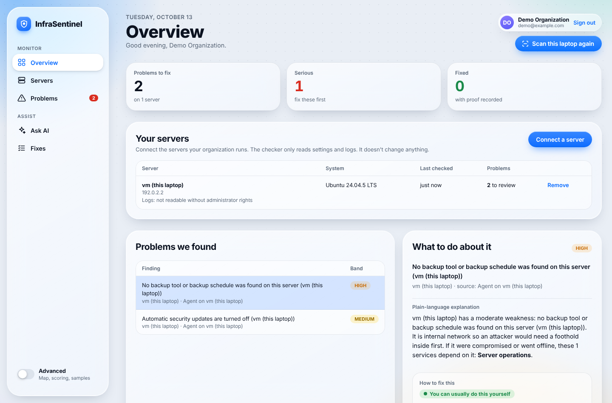
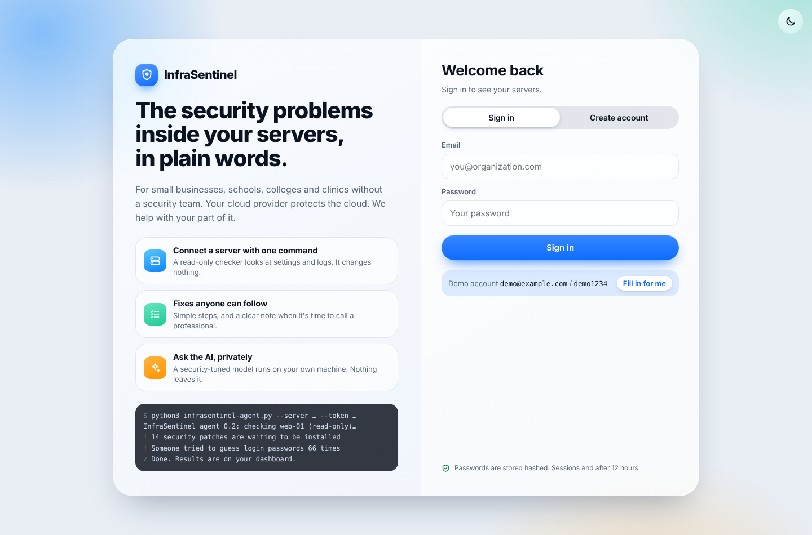
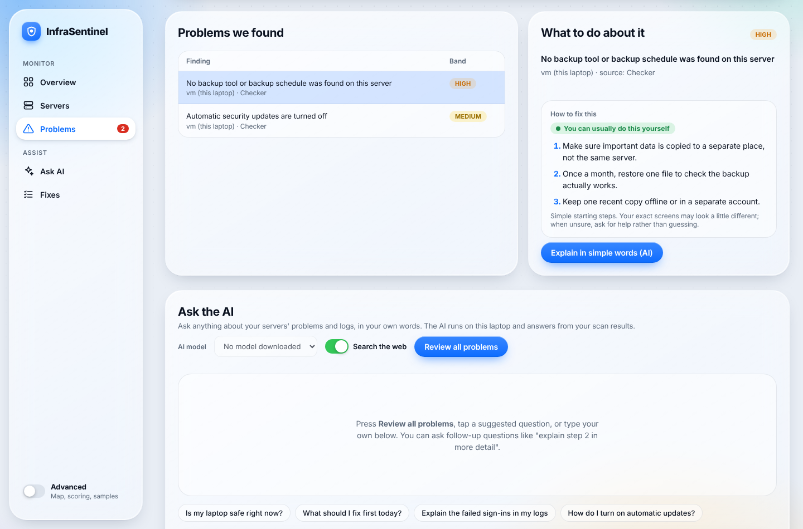
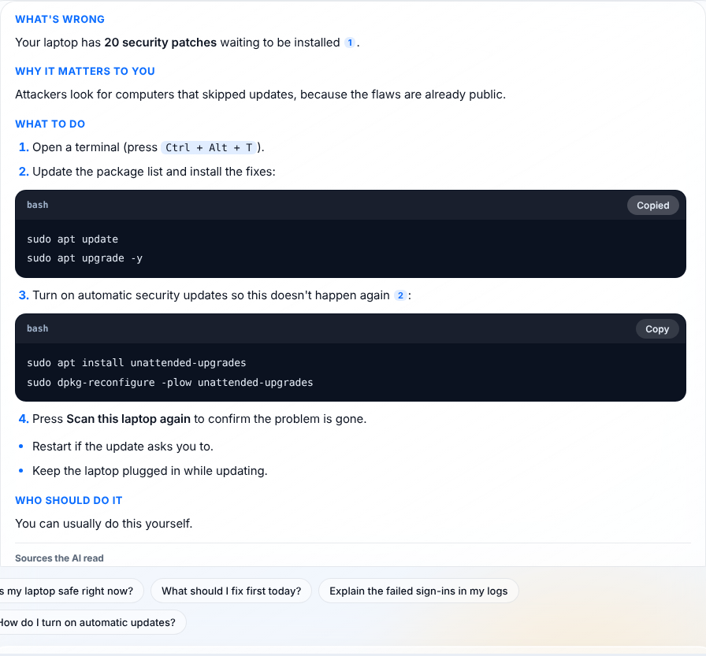
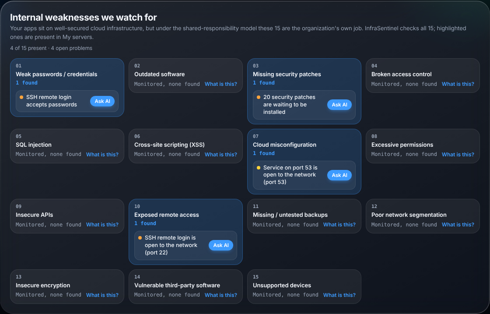
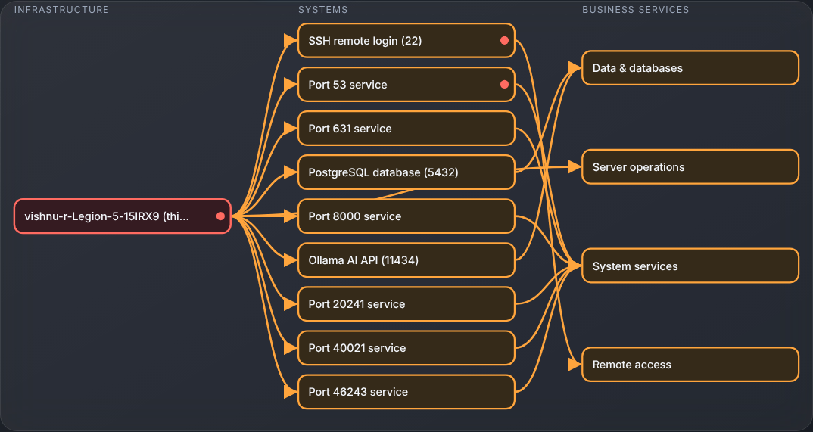
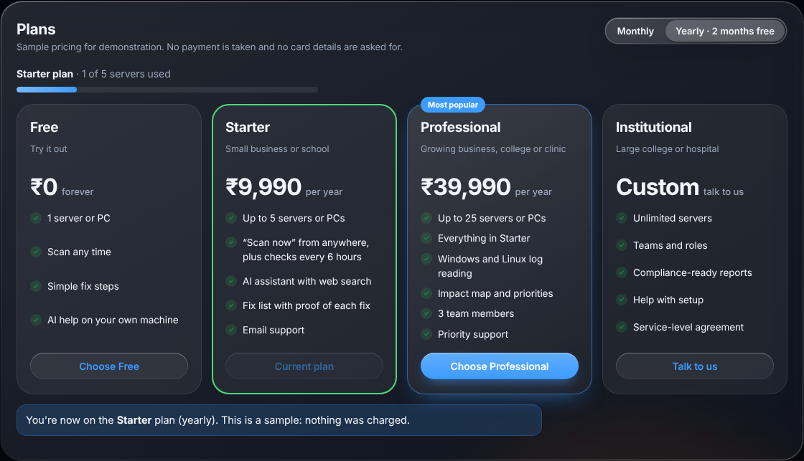
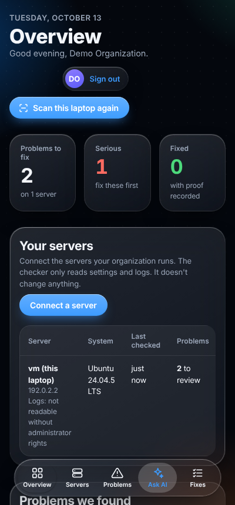

# InfraSentinel

**Plain-language security checks for small businesses, schools, colleges and clinics.**

InfraSentinel finds the security problems inside an organization's own servers and laptops, explains each one in plain words, tells the owner what to fix first and who should fix it, and records proof when it's fixed. A security-tuned AI model runs privately on your own machine to answer questions.

> Your cloud provider protects the cloud. InfraSentinel helps with your part of it:
> passwords, updates, open services, admin rights, settings, backups and logs.



---

## Contents

- [Features](#features)
- [Quick start](#quick-start)
- [Connect a server or PC](#connect-a-server-or-pc)
- [Share it publicly](#share-it-publicly)
- [How it works](#how-it-works)
- [What the checker looks at](#what-the-checker-looks-at)
- [How risk is scored](#how-risk-is-scored)
- [The AI assistant](#the-ai-assistant)
- [Security and privacy](#security-and-privacy)
- [Project structure](#project-structure)
- [Configuration](#configuration)
- [API](#api)
- [Limitations and roadmap](#limitations-and-roadmap)
- [Screenshots](#screenshots)

---

## Features

- **Accounts per organization.** Each organization signs in and only ever sees its own machines.
- **Connect any server or PC with one command.** A small, read-only checker (Linux, Windows; basic on macOS) reports what it finds.
- **Problems in plain language.** Every problem has simple fix steps and a clear label: *You can do this yourself*, *Best with your IT person*, or *Call a security professional*.
- **Explainable risk scores.** A fixed formula ranks problems by severity, exposure and how important the asset is to the organization. The same flaw can be critical on one server and minor on another.
- **Ask the AI.** A local, security-tuned model (Cisco Foundation-Sec 8B via Ollama) explains problems, reviews all of them, reads log summaries, and answers follow-up questions. Optional web search cites its sources. Commands appear in copyable code boxes.
- **Scan now, remotely.** A machine can stay listening so the dashboard can trigger a fresh scan from anywhere, without opening any ports.
- **Security log reading.** Failed sign-ins and where they came from, root/administrator sign-ins, failed admin attempts, new accounts, system errors.
- **Fix list with proof.** A fix only counts as verified when evidence is recorded.
- **Impact map and simulation** (Advanced view). See which business services depend on an asset and what a failure would affect.
- **15 weakness categories** with the problems found in each, plus *Ask AI* and *What is this?* buttons.
- **Sample subscription plans**, light/dark theme, iOS-style Liquid Glass design, phone-friendly layout.

## Quick start

Requirements: **Linux or macOS**, **Python 3.9+**. Optional: [Ollama](https://ollama.com/download) for the AI assistant (an 8 GB GPU is comfortable; CPU works but is slower).

```bash
git clone https://github.com/<your-username>/infrasentinel.git
cd infrasentinel
bash start.sh
```

Open **http://127.0.0.1:8765** and sign in with the demo account **demo@example.com / demo1234**, or create your own account.

The first time, `start.sh` starts Ollama and downloads the AI model (about 5 GB). Then press **Scan this laptop** to check the machine running InfraSentinel.

| Command | What it does |
|---|---|
| `bash start.sh` | Dashboard for this computer only |
| `bash start.sh --lan` | Also reachable by machines on the same Wi-Fi / network |
| `bash start.sh --public` | A public `https://…trycloudflare.com` link anyone can open |

## Connect a server or PC

In the dashboard, open **Your servers → Connect a server**, pick **Linux or Mac** or **Windows**, choose the options, and copy the command. Run it on the machine you want to check.

Linux / macOS:

```bash
curl -fsSL https://YOUR-DASHBOARD/agent.py -o infrasentinel-agent.py && python3 infrasentinel-agent.py --server https://YOUR-DASHBOARD --token YOUR-ACCESS-CODE --watch
```

Windows (works in Command Prompt, PowerShell or Windows Terminal; needs Python 3 from python.org):

```text
powershell -NoProfile -ExecutionPolicy Bypass -Command "Set-Location ([IO.Path]::GetTempPath()); irm https://YOUR-DASHBOARD/agent.py -OutFile infrasentinel-agent.py; py infrasentinel-agent.py --server https://YOUR-DASHBOARD --token YOUR-ACCESS-CODE --watch"
```

The dashboard fills in your address and access code for you.

Checker options:

| Option | Meaning |
|---|---|
| `--watch` | Stay running so the dashboard's **Scan now** works (checks in every 15 s, re-checks every 6 h) |
| `--install` | Keep it running after restarts (cron on Linux, Task Scheduler on Windows) |
| `--dry-run` | Print exactly what would be sent, and send nothing |
| `--no-logs` | Don't read or send any log information |
| `--uninstall` | Remove the schedule and files |

Run with `sudo` (Linux) or an administrator terminal (Windows) to include admin-only checks.

## Share it publicly

```bash
bash start.sh --public
```

This downloads Cloudflare's free tunnel program once and prints a public HTTPS link. It stays open while the terminal runs; **Ctrl+C** closes it. The link changes each start.

While public:

- the demo password is replaced by a one-off password printed in the terminal
- **Scan this laptop** and changing the AI model only work on the host machine
- each account can make 20 AI requests per 10 minutes
- "Connect a server" commands use the public link, so machines anywhere can report in

## How it works

```
 Owner's browser  ⟷  InfraSentinel server  ⟷  Checker on each machine
  (dashboard)          (Python, this repo)      (agent.py, read-only)
                              │
                 ┌────────────┴────────────┐
           Local AI (Ollama)        Web search (optional)
           Foundation-Sec 8B        DuckDuckGo / Ollama web search
```

1. The owner signs in and copies a command from **Connect a server**.
2. The checker reads the machine's settings and logs and sends a report over HTTPS with the organization's access code.
3. The server scores each problem, attaches fix steps and "who should fix it", and shows it in the dashboard.
4. With `--watch`, the checker asks the server every 15 seconds whether someone pressed **Scan now**. All connections go outward, so no firewall changes are needed.

The server uses only the Python standard library. Data is stored as JSON files in `data/`.

## What the checker looks at

All checks are read-only.

**Linux:** services open to the network · SSH password and root login · waiting security patches · automatic updates · OS end of support · firewall service · extra admin (UID 0) accounts · admin group size · password file permissions · empty passwords (sudo) · backup tools · security logs for the last 7 days (failed sign-ins and sources, root sign-ins, failed sudo, new accounts, system errors).

**Windows:** Windows Firewall per network profile · Microsoft Defender real-time protection and definition age · days since the last update · auto-update policy · Windows version support · Remote Desktop and Network Level Authentication · SMBv1 · administrators, built-in Administrator, Guest · UAC · password length and lockout · BitLocker (admin) · backup tools / File History · event logs (4625 failed sign-ins, 4624 remote sign-ins, 4720 new accounts, System errors).

Every problem is filed under one of 15 categories: weak passwords, outdated software, missing patches, broken access control, SQL injection, cross-site scripting, misconfiguration, excessive permissions, insecure APIs, exposed remote access, missing backups, poor network segmentation, insecure encryption, vulnerable third-party software, unsupported devices.

## How risk is scored

```
Risk = 0.4 × Severity + 0.3 × Exposure + 0.3 × Criticality
```

- **Severity** (0–100): CVSS score × 10.
- **Exposure:** internet 90 · local network 70 · internal 45 · isolated 15 · unknown 50 (flagged, never assumed safe).
- **Criticality:** importance to the organization. An asset inherits the criticality of the most important service that depends on it.

Bands: **Critical 80–100**, **High 60–79**, **Medium 30–59**, **Low 0–29**. Anything Critical is always marked *Call a security professional*.

The AI never changes a score. The weights are illustrative and meant to be calibrated with real pilots.

## The AI assistant

- Runs through **Ollama** on your own machine. The default model is **Foundation-Sec-8B-Instruct** (Cisco Foundation AI, built on Llama 3.1 8B), about 5 GB. Switch models in **Ask the AI → AI model**.
- Explains one problem, reviews all problems, reads a server's log summary, or answers your own questions, with follow-ups.
- Uses only your scan data for facts about your systems; general security knowledge for how-to steps.
- Hidden "thinking" is turned off so answers aren't cut short; answers stream in as they're written.
- **Search the web** (on by default): searches for the problem plus your OS, reads the top pages, and cites them as [1], [2]. Only public pages are fetched; private network addresses are blocked. Set `OLLAMA_API_KEY` to use Ollama's web search instead of DuckDuckGo.

## Security and privacy

- The checker only reads; `--dry-run` shows exactly what is sent; `--uninstall` removes it.
- The checker only reports on the machine it runs on. It never scans other machines.
- Passwords are hashed with PBKDF2-SHA256 (200,000 rounds). Sessions are HttpOnly cookies that expire after 12 hours.
- Each organization has its own data and access code. A leaked access code can only send reports; **Reset access code** disables old commands.
- Scan results and logs go only to the local AI. With web search on, only the search words leave the machine.
- This is a prototype: data is stored in files and traffic is plain HTTP unless you use `--public` (HTTPS through Cloudflare). Put it behind HTTPS before real use.
- Only connect machines you own or are authorized to check.

## Project structure

```
infrasentinel/
├── server.py              Web server and API: accounts, sessions, reports, scoring data, AI, web search, public mode
├── agent.py               Read-only checker for Linux, Windows and macOS (Python standard library only)
├── index.html             Dashboard (problems, fixes, impact map, coverage, Ask the AI)
├── app.js                 App layer: navigation, servers, Scan now, AI chat, plans, theme
├── theme.css              Liquid Glass theme (light and dark)
├── login.html             Sign-in and create-account page
├── start.sh               Starts Ollama, downloads the model, opens a public link with --public
├── data/
│   └── organizations.json Sample organizations for demos (Advanced view)
└── docs/
    ├── pitch-prep.html    Team briefing and judge Q&A practice
    └── screenshots/
```

Created at runtime and **not** committed (see `.gitignore`): `data/users.json`, `data/accounts.json`, `data/hosts/`, `data/remediation_*.json`, `data/settings.json`, `bin/cloudflared`.

## Configuration

| Variable | Default | Purpose |
|---|---|---|
| `IS_PORT` | `8765` | Port for the dashboard |
| `IS_MODEL` | Foundation-Sec 8B | Ollama model to download and prefer |
| `IS_CTX` | `12288` | AI context window (tokens) |
| `OLLAMA_HOST` | `http://127.0.0.1:11434` | Where Ollama runs |
| `OLLAMA_API_KEY` | – | Use Ollama's web search for "Search the web" |
| `IS_BIND=0.0.0.0` | – | Same as `--lan` |

## API

| Method | Path | Purpose |
|---|---|---|
| POST | `/api/signup`, `/api/login`, `/api/logout` | Accounts |
| GET | `/api/me`, `/api/config` | Current user, public-mode settings |
| GET | `/api/hosts` | Connected machines and their problems |
| POST | `/api/hosts/scan-now`, `/api/hosts/remove` | Request a scan, remove a machine |
| GET | `/api/agent/info` | Access code and command address |
| POST | `/api/agent/report`, `/api/agent/poll` | Used by the checker (access-code header) |
| POST | `/api/agent/reset-token` | Disable old commands |
| POST | `/api/scan-self` | Scan the host machine (local only) |
| POST | `/api/ai/stream` | Streamed AI answers (explain, summary, logs, chat) |
| GET/POST | `/api/ai/models`, `/api/ai/model` | List / choose the AI model |
| POST | `/api/remediation`, `/api/plan` | Save fix status, choose a sample plan |

## Limitations and roadmap

**Today (prototype):** runs on one machine; JSON-file storage; quick-tunnel links change each start; firewall and backup checks are best guesses; no website code testing (SQL injection / XSS); Windows needs Python; plans are samples with no payments; score weights need calibrating.

**Next:** hosted service with a database and domain · one-click installers · import findings from Greenbone, Wazuh and OWASP ZAP · automatic fix verification on re-scan · alerts by email or WhatsApp · team roles · reports that support good practice under India's DPDP Act.

## Screenshots

| | |
|---|---|
|  |  |
|  |  |
|  |  |

<p align="center"></p>

## Credits

- [Ollama](https://ollama.com) for running local models
- [Foundation-Sec-8B-Instruct](https://huggingface.co/fdtn-ai/Foundation-Sec-8B-Instruct) by Cisco Foundation AI (check its license before commercial use)
- [Cloudflare Tunnel](https://developers.cloudflare.com/cloudflare-one/connections/connect-networks/) for public links

No license has been chosen yet. Add one (for example MIT) if you want others to reuse the code.
